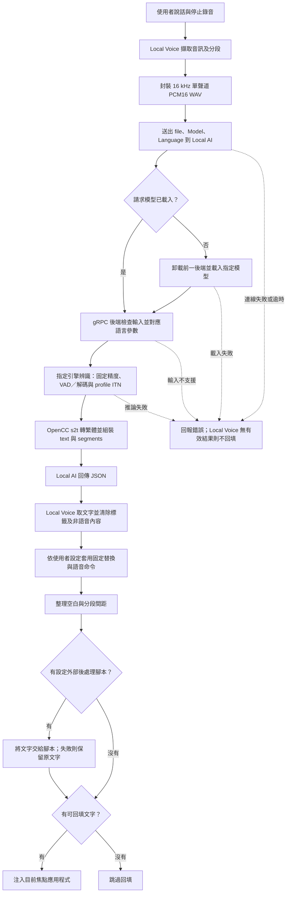
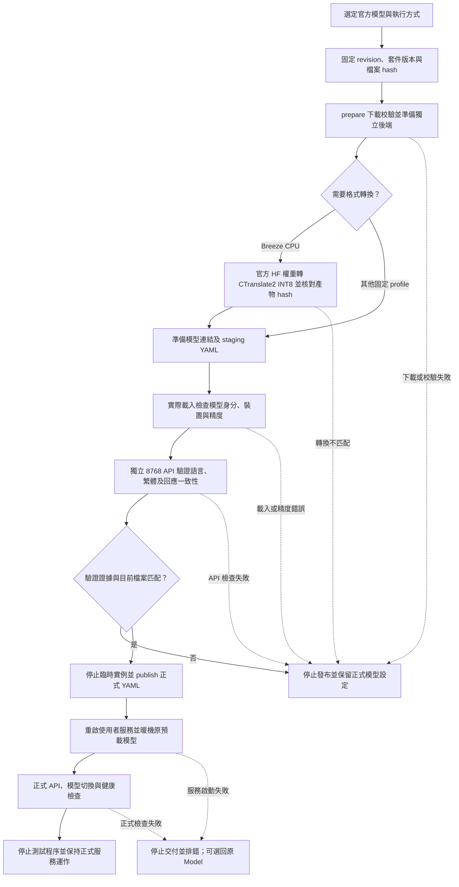

# LocalAI ASR：繁體輸出與模型切換

## 給人看的：用途與能力

### 它是做什麼的

這是 Linux 本機語音辨識部署工具，提供 LocalAI 原生 Web UI 與 OpenAI 相容的音訊上傳 API。VocaLinux 或其他支援 `/v1/audio/transcriptions` 的應用程式可以使用它；預設只監聽 `127.0.0.1:8767`，無需 API key。

預設模型是官方 SenseVoiceSmall CPU FP32。辨識完成後，原生 FunASR 後端用 OpenCC `s2t` 將文字轉為繁體，再交給 LocalAI 回應。整段 `text` 與各個 `segments[].text` 使用同一個結果；英文、數字及格式保留，沒有 LLM 潤飾或翻譯。繁體轉換不會修正 ASR 聽錯的詞。

### 語音轉錄與調整位置

Local Voice 負責錄音及文字回填，Local AI 負責依 Model 載入對應後端。下圖描述 Remote Server 與焦點程式回填的配置，其他內建引擎及 Dictation Pad 需另外追蹤。本 repo 調整的是模型接入、語言參數、推論精度、字詞轉繁體及服務生命週期。沒有實作模型微調、自動選模型、雙模型融合或文字 LLM 修正；Nano 等生成式 ASR 內部的 decoder 屬於模型本身。

<!-- diagram:transcription-flow:start -->

<!-- diagram:transcription-flow:end -->

圖中的 Local Voice 為外部程式，本 repo 沒有修改其原始碼。其錄音切段與可選文字處理會影響送進 ASR 的音訊和最後回填的文字；它們與後端自己的 VAD／解碼分開。Local Voice 的格式清理及目前設定快照，見 [來源查核](validation/voice-flow-source.json)與 [Remote API 文件](https://github.com/VocaHQ/vocalinux/blob/main/docs/HTTP_REMOTE.md)。設定快照不保證執行中程式已重載同一份設定。

| 功能 | 作用與入口 | 對結果或速度的影響 | 驗證與界線 |
| --- | --- | --- | --- |
| 音訊擷取及分段 | Local Voice `audio/capture.py`、`speech_recognition/recognition_manager.py`；錄音及靜音設定 | downmix／重採樣成 16 kHz mono int16；靜音分段或放開按鍵後送出 | 錄音切點可能改變上下文；未測使用者麥克風 |
| WAV、Model、Language 請求 | Local Voice Remote Server；`POST /v1/audio/transcriptions` | Auto 省略 language；明確語言送出對應代碼；Model 決定所用模型 | 本機程式的 HTTP timeout 為 30 秒；OpenAI/FunASR 是格式名稱 |
| 選模及記憶體管理 | LocalAI、模型 YAML、`deploy.py` 產生的 `--max-active-backends 1` | 依請求載入模型並卸載前一後端；常駐可省去再次載入 | GUI Load 不會改 Local Voice 的 Model；沒有智慧路由 |
| 語言與 gRPC 接入 | 固定原生後端補丁，及 `scripts/cpu_asr_backend.py`、`scripts/nano_hf_backend.py`、`scripts/breeze_backend.py` | 各引擎接受的語言格式不同；Qwen CPU 的 zh/en 轉為 Chinese/English | FireRed 僅 Auto；接入程式不融合多個辨識結果 |
| CPU／GPU、精度及執行緒 | `config/versions.json`、各 profile、安裝工具 | FP32、Q8／INT8、CPU／GPU 及執行緒影響記憶體、速度，量化亦可能影響辨識 | 精度與實際載入證據見模型表及 VALIDATION；GPU 本身不會補足英文能力 |
| VAD、解碼與 ITN | PyTorch FunASR 使用 FSMN VAD；Breeze、Sherpa 不另加 VAD；Sherpa SenseVoice 的 `use_itn=True` | 切段、beam search、語言提示、數字等文字正規化與生成上限可能改變輸出 | PyTorch SenseVoice 未開 ITN；不同部署不只比較權重；Nano 拒絕未結束的截斷輸出 |
| 繁體轉換 | [transcription_conversion.py](scripts/transcription_conversion.py)，OpenCC `s2t` | 改字形、異體及部分詞形；text／segments／有提供時的 words 保持一致 | 不補英文、不修正聽錯詞，亦非臺灣用詞替換 `s2twp` |
| 回應清理 | Local Voice `recognition_manager.py` | 取 text，必要時取 segments；去開頭 metadata tags 與非語音內容 | 無有效文字或請求失敗時不回填，不自動改用另一個 ASR 模型 |
| 固定文字替換及語音命令 | Local Voice `custom_dictionary.py` 與語音命令設定 | 有規則時可替換已辨識文字；語音命令可能消耗文字並觸發動作 | 查核時未發現替換規則，Remote API 的語音命令為關閉；使用者可自行變更 |
| 外部文字後處理 | Local Voice `post_processing.script_path`、`post_processor.py` | 有腳本時 stdin 傳文字、stdout 取代結果；失敗保留原文，空輸出不回填 | 查核時腳本路徑為空；本專案沒有配置 OpenCC 或 LLM 外部腳本 |
| 空白整理與回填 | Local Voice `main.py`、`text_injection/text_injector.py` | 整理首尾空白及分段間距，再注入目前焦點程式 | 依桌面環境選 IBus／輸入工具或貼上 fallback；沒有驗證使用者端完整聽寫 |
| 啟動暖機與功能檢查 | `deploy.py` 生成的 systemd `ExecStartPost`、`scripts/check_api.py`，及各模型驗證程式 | 服務預載後先以中文短樣本暖機；切換其他模型仍需首次載入 | 通過功能測試不等於比其他模型更準；實測範圍見 [VALIDATION](VALIDATION.md) |
| 固定來源、下載與轉換 | `config/versions.json`、各 `add_*.py` 的 prepare | 核對官方來源及 hash；Breeze 轉 CTranslate2 INT8，並核對轉換產物 | hash 不匹配會停止，不以改名冒充另一模型 |
| 獨立驗證與發布 | `scripts/verify_model.py`、`check_*_api.py`、各安裝工具的 publish | 實際載入與 staging API 通過後，核對證據才發布正式 YAML | 功能證據限於實際測過的格式、語言及樣本；不能代替準確率評測 |

目前最佳化集中在部署與推論設定。體感等待還包含 Local Voice 的錄音分段、網路請求、模型切換、排隊、推論及回填；單看暖機後 API 秒數不能代表完整聽寫延遲。已下載模型可切換使用；不同精度與前後處理的結果應用同一段原始音訊比較。

### 擴充模型的安裝與發布流程

此圖適用 `add_whisper.py`、`add_cpu_asr.py`、`add_nano_hf.py` 及 `add_breeze.py`。原始 FunASR 的 `deploy.py install/switch` 直接管理服務與預載，不使用這組 staging／publish 步驟。

<!-- diagram:model-deployment:start -->

<!-- diagram:model-deployment:end -->

圖的來源為 [轉錄流程](diagrams/transcription-flow.mmd)與 [擴充模型部署](diagrams/model-deployment.mmd)。變更功能時，須同步更新圖與上表，這是 [AGENTS.md](AGENTS.md) 的硬性完成條件。執行 `python3 scripts/diagrams.py` 同步 README，再用 `python3 scripts/diagrams.py --check` 檢查。GitHub 可直接渲染 Mermaid；本機語法與圖面驗證命令如下，SVG 為 `.localai/` 內的衍生檔案：

```bash
PUPPETEER_SKIP_DOWNLOAD=1 npm_config_cache="$PWD/.localai/cache/npm" \
  npm install --prefix .localai/diagram-tools --no-save --ignore-scripts @mermaid-js/mermaid-cli@11.12.0
python3 scripts/diagrams.py
python3 scripts/diagrams.py --check
python3 - <<'PY'
import json
from pathlib import Path
Path('.localai/reports/mermaid-browser.json').write_text(json.dumps({
    'executablePath': '/usr/bin/google-chrome', 'args': ['--no-sandbox']}))
PY
for source in diagrams/*.mmd; do
  .localai/diagram-tools/node_modules/.bin/mmdc -i "$source" \
    -o ".localai/reports/$(basename "$source" .mmd).svg" \
    -p .localai/reports/mermaid-browser.json
done
```

`mermaid-browser.json` 是本機渲染器設定，指向已安裝的 Chrome；圖面驗證的工具與系統環境不會改動 ASR runtime。

### 可以切換的模型

| Profile／API Model | 官方來源 | Runtime | 此 profile 精度 |
| --- | --- | --- | --- |
| `sensevoice-fp32`，預設 | `FunAudioLLM/SenseVoiceSmall` | 原生 FunASR／PyTorch CPU | FP32，實際載入 917 個 float32 參數張量 |
| `paraformer-zh` | `funasr/paraformer-zh` | 原生 FunASR／PyTorch CPU | 此 profile 為 float32，實測 956 個參數張量 |
| `whisper-large-v3` | `Systran/faster-whisper-large-v3` | 原生 faster-whisper／CTranslate2 NVIDIA GPU | GPU FP32 推論，獨立固定後端與小補丁 |
| `whisper-large-v3-turbo` | `mobiuslabsgmbh/faster-whisper-large-v3-turbo` | 與完整 Whisper 共用原生 GPU 後端 | GPU FP32 推論，獨立權重與模型設定 |
| `qwen3-asr-0.6b-cpu` | Qwen3-ASR，`audio-cpp/audio.cpp-gguf` 轉換 | 原生 audio.cpp，CPU | Q8_0 權重，0.6B |
| `qwen3-asr-1.7b-cpu` | Qwen3-ASR，`audio-cpp/audio.cpp-gguf` 轉換 | 原生 audio.cpp，CPU | Q8_0 權重，1.7B |
| `fireredasr2-aed-cpu` | `FireRedTeam/FireRedASR2-AED` | 官方 AED／PyTorch CPU | FP32，只支援 Auto 語言模式 |
| `fun-asr-nano-2512-hf-cpu` | `FunAudioLLM/Fun-ASR-Nano-2512-hf` | 原生 Transformers，獨立 CPU runtime | CPU FP32 推論，官方 HF checkpoint |
| `breeze-asr-25-cpu` | `MediaTek-Research/Breeze-ASR-25` | 獨立 faster-whisper／CTranslate2 CPU | 官方權重本機轉 INT8，台灣華語與中英混合 |
| `breeze-asr-26-cpu` | `MediaTek-Research/Breeze-ASR-26` | 與 Breeze 25 共用獨立 CPU runtime | 官方權重本機轉 INT8，台語輸入轉華語中文字 |
| `sensevoice-onnx-cpu` | SenseVoiceSmall，k2-fsa 官方 Sherpa ONNX 匯出 | sherpa-onnx／ONNX Runtime CPU | FP32，917 個 FLOAT initializer，ITN 開啟 |

上述模型使用固定來源 revision 與檔案 hash。Whisper 使用獨立 NVIDIA GPU 後端，透過 GUI 或 API Model 切換；既有兩個 FunASR profile 也支援下方的 CLI 預載切換。LocalAI 最多保留一個自己的模型常駐，下載檔保留，供再次切換。不是只改 model 名稱；詳細證據在 [VALIDATION.md](VALIDATION.md)。

其他 profile 的精度由它自己的配置決定，不能把 SenseVoice 的 FP32 保證套到所有模型。驗證範圍限於表中的固定 profile，沒有宣稱支援所有 ASR runtime。

### GUI 與應用程式

預設 GUI：[LocalAI Installed 模型管理](http://127.0.0.1:8767/app/models?view=installed)。在 Installed 選模型，可 Load／Stop、Actions → Edit configuration、開啟 Transcribe。首次使用第二個 profile，先執行下面的 `switch` 下載及驗證；兩個模型都安裝後，GUI 可 Load 另一個模型，LocalAI 會卸載前一個。

VocaLinux 的精確模型名稱、語言選擇與管理頁載入規則，見 [設定與切換規則](VocaLinux-設定與切換規則.md)。加入 Whisper 或新 CPU 模型不會更改開機預載或 VocaLinux 設定。

CLI 切換並保存重啟後的 FunASR 預設模型：

```bash
python3 deploy.py switch paraformer-zh
python3 deploy.py switch sensevoice-fp32
```

GUI 的 Load 與 API 的 `model` 決定當次實際使用的模型；CLI `switch` 同時保存啟動時的預載選擇。GUI 不會改寫部署工具的選擇檔，重啟後仍使用 CLI 保存的 profile。

| VocaLinux 欄位 | 預設值 |
| --- | --- |
| Server URL | `http://127.0.0.1:8767` |
| API Endpoint | `OpenAI/FunASR (/v1/audio/transcriptions)` |
| 精確 endpoint | `/v1/audio/transcriptions` |
| Model | 上表中的精確 API Model 名稱，官方 Nano CPU 版用 `fun-asr-nano-2512-hf-cpu` |
| API Key | 留空 |
| Language | FireRed 一律 Auto；其他模型中文可先用 `zh`，純英文用 `en`，自動辨識用 `auto` |

VocaLinux 設定由使用者修改。API request 的 `model` 必須選真正要用的 profile；若仍送 SenseVoice，即使先前 CLI 選了 Paraformer，LocalAI 仍會載入 SenseVoice 來處理該請求。各模型的語言規則見 [設定與切換規則](VocaLinux-設定與切換規則.md)。

### 能力的界線

上述模型的 JSON 音訊轉錄已驗證繁體輸出，SenseVoice FP32 已驗證權重與載入參數；不保證中英混用更準。測試中的 `training` 仍有誤辨，字詞轉繁體不會改善它。

兩個 FunASR profile 的原生後端額外使用 FSMN VAD，沒有開啟 ITN，也沒有新增標點模型。原生 `rich_transcription_postprocess` 可能保留情緒／事件符號。OpenCC `s2t` 做字詞及異體轉換，並非 `s2twp` 的臺灣用詞替換；含糊字形的字典選擇仍可能不合使用者偏好。

Web UI／API 都由同一個 LocalAI HTTP 埠提供，沒有新增代理或第二個 HTTP 埠。LocalAI 自動啟動的原生 FunASR gRPC 使用 loopback 動態埠，不對外公開。

## 給 AI agent 看的：安裝、部署和應用

### 範圍與前提

使用此 repo 的固定版本、profile 與可校驗的後端擴充。維持 SenseVoice 預設 CPU FP32、loopback 與使用者既有服務；不得改用量化版來通過 SenseVoice 驗收。其他 profile 依自身 precision 驗證。

- Linux x86_64／glibc。已測 Ubuntu 26.04.1 LTS，其他架構與系統未測。
- Python 3.11 以上、curl、ffmpeg、bash、可用的 `systemctl --user`。官方後端封裝自己的 Python 3.12，工具不修改系統 Python；不需要 Docker 或 uv。
- 至少 6 GiB 可用磁碟、4 GiB 可用 RAM；多個模型的下載檔與載入尖峰需要更多空間。切換時先卸載本 repo 的服務，驗證後才啟動新模型。
- 首次安裝需要 GitHub、quay.io、Hugging Face、PyPI 與 ModelScope 的 HTTPS 網路。VAD cache 即使存在，仍可能檢查 ModelScope，完全斷網啟動未測。
- checkout 與 Python 路徑不含空白、引號、`$`、`%`、反斜線；安裝後保持 checkout 位置。

Ubuntu 的前提範例：

```bash
sudo apt-get install python3 curl ffmpeg git libgomp1 libsndfile1
systemctl --user show-environment
```

系統套件在測試機器原已存在，apt 範例沒有當作乾淨 OS 重建證據。登出後持續運作需要 `Linger=yes`；先查 `loginctl show-user "$USER" -p Linger`，必要時由使用者依系統政策啟用。本次沒有測從 `no` 啟用或重新開機。

### 固定來源與繁體擴充

[config/versions.json](config/versions.json) 是版本／權重／hash 的來源：LocalAI v4.11.0 binary、官方 CPU FunASR OCI digest、原始 backend.py SHA256、各個模型的 HF revision 與完整必要檔案、VAD 檔案，以及 OpenCC 0.1.7 wheel。

v4.11.0 的音訊 endpoint 沒有已驗證的通用 OpenCC 配置；chat filter 不適用。`prepare_conversion()` 檢查原始 backend.py hash，保存 `backend.upstream.py`，以兩個唯一 anchor 加入 conversion import，並在原生 transcript 組裝前呼叫 `convert_text()`。補丁只改 import 與 segment 後處理，不修改權重或推論精度。

下載的固定 wheel 解出 OpenCC 套件，後端以 symlink 存取；原創的 [scripts/transcription_conversion.py](scripts/transcription_conversion.py) 使用 `s2t`。原始 hash、補丁後 hash、模組與 wheel hash 記錄在 `.localai/reports/backend-extension.json`。重跑只接受原始或確定的已套用內容，未知改動會停止，不會覆蓋人工修改。升級後端必須重新檢查 anchor、hash、實際 dtype 與 HTTP 輸出。

### 安裝、更新與啟動

先確認空埠、資源與 user systemd。不要停止無關服務或操作 VocaLinux。

```bash
git clone https://github.com/OfficeWorkTools/localai-sensevoice-fp32.git
cd localai-sensevoice-fp32
python3 deploy.py install --model sensevoice-fp32
```

已有程式使用 8767 時，先用空埠驗證：

```bash
python3 deploy.py install --port 8768 --model sensevoice-fp32
```

工具計算 checkout 根目錄，所有 runtime 在 `.localai/`，生成的 user systemd 單元為 `localai-sensevoice-fp32.service`。下載支援重試、暫存檔及 hash；模型、後端二進位、cache、音訊、log 不進 Git。

安裝會初始化官方可攜 Python、準備模型 symlink 與 OpenCC 擴充、驗證轉換和實際模型，啟動並以中文音訊暖機，再跑真實 API 自測。只有 warmup 成功後 systemd 才進入 running。`--galleries=[]` 避開 v4.11.0 預設 GGUF gallery 預估預載的崩潰；Explore 空白，Installed、匯入及設定仍可用。

更新已安裝的同一 checkout：

```bash
git pull --ff-only
python3 deploy.py install
python3 deploy.py restart
python3 deploy.py test
```

重跑保留原選擇的 profile 與埠；需要恢復 SenseVoice 時明確指定 `--model sensevoice-fp32`。工具只控制自己生成、且屬於此 checkout 的單元，拒絕接管其他 checkout。搬移 checkout 前先 stop／disable，確認舊單元停止後移除那份自己生成的單元，再在新位置安裝。

### 真正切換模型

```bash
python3 deploy.py switch paraformer-zh
python3 deploy.py verify-model
python3 deploy.py test
python3 deploy.py switch sensevoice-fp32
python3 deploy.py verify-fp32
python3 deploy.py test
```

`switch` 會卸載目前模型，下載並校驗所選官方 profile 的實際檔案，更新模型 YAML、symlink、保存的選擇及 systemd 預載，再驗證、暖機、測試。已下載且 hash 匹配的檔案會重用，不刪除原權重。預設的 FP32 保證專指 SenseVoice；目前 Paraformer profile 的驗證資料另記錄它的 class、956 個 float32 參數張量與不同權重 SHA256。

兩個已驗證 profile 共用固定原生 FunASR CPU backend，因此不需要新增第二個 runtime。其他 backend 必須有自己的固定依賴、下載校驗與實測。Whisper 共用後端與完整模型的來源在 `config/versions.json` 的 `whisper` 區段，Turbo 的獨立權重來源在 `whisper_turbo` 區段，由 `add_whisper.py` 管理，不在 `deploy.py switch` 的 FunASR profile 選單內；不能用 FunASR 補丁代替 Whisper 驗證。

### 加入完整 Whisper large-v3 GPU 模型

這是選用安裝，先完成既有 LocalAI 安裝，並使用有 NVIDIA GPU 的 Linux x86_64。本機驗證卡為 RTX 4060 Ti 16GB；SenseVoice 預設及 VocaLinux 設定由原選擇保留。

```bash
python3 add_whisper.py prepare
LD_LIBRARY_PATH="$PWD/.localai/backends/cuda12-faster-whisper/lib" \
  .localai/backends/cuda12-faster-whisper/venv/bin/python scripts/verify_model.py whisper-large-v3
```

prepare 下載固定 OCI 後端及完整 large-v3 權重，核對 hash，加入 GPU FP32、language 傳遞與 OpenCC s2t 的小補丁。模型 YAML 先放在 `.localai/whisper-staging/models`，正式清單尚未發布。已知後端及模型會重用；未知檔案改動會停止。

在另一個終端機啟動獨立測試埠，先確認 8768 沒有其他服務使用：

```bash
.localai/bin/local-ai run --address 127.0.0.1:8768 \
  --models-path "$PWD/.localai/whisper-staging/models" \
  --backends-path "$PWD/.localai/backends" \
  --data-path "$PWD/.localai/whisper-staging/data" \
  --galleries=[] --threads 8 --load-to-memory whisper-large-v3 --max-active-backends 1
```

等測試服務 ready 後，在原終端機執行 API 測試：

```bash
python3 scripts/check_whisper_api.py --port 8768
```

在測試服務的終端機按 Ctrl+C 停止該實例，再發布已通過的設定：

```bash
python3 add_whisper.py publish
python3 deploy.py restart
python3 scripts/check_whisper_api.py --port 8767
```

publish 檢查原生 CUDA FP32 驗證與獨立埠 API 證據，再把 `whisper-large-v3` 加入正式模型目錄。API 測試的英文錄音由固定 Whisper 測試檔下載並轉成 PCM16 WAV。測試會載入 Whisper；要回復原本使用方式，依 [VocaLinux 設定與切換規則](VocaLinux-設定與切換規則.md) 選回 SenseVoice。具體已驗證範圍與未測項目見 [VALIDATION](VALIDATION.md)。

### 加入 Whisper large-v3-turbo

Turbo 共用上述固定 NVIDIA 後端、FP32 推論與 OpenCC 小補丁，另有固定 revision、檔案 hash、權重目錄與 API Model 名稱。已安裝完整版本時會重用後端，預載選擇與 VocaLinux 設定保持原值。

```bash
python3 add_whisper.py prepare --model whisper-large-v3-turbo
LD_LIBRARY_PATH="$PWD/.localai/backends/cuda12-faster-whisper/lib" \
  .localai/backends/cuda12-faster-whisper/venv/bin/python scripts/verify_model.py whisper-large-v3-turbo
```

沿用上方獨立 8768 埠的 LocalAI 啟動指令，把 `--load-to-memory` 改為 `whisper-large-v3-turbo`，其餘路徑相同。ready 後驗證 Turbo：

```bash
python3 scripts/check_whisper_api.py --port 8768 --model whisper-large-v3-turbo
```

停止該臨時測試實例，再發布與重啟正式服務：

```bash
python3 add_whisper.py publish --model whisper-large-v3-turbo
python3 deploy.py restart
python3 scripts/check_whisper_api.py --port 8767 --model whisper-large-v3-turbo
```

每個 Whisper profile 使用各自的原生載入及 API 證據，發布時檢查模型 ID、權重 hash、設定 hash 與後端補丁 hash，防止混用完整版本與 Turbo 的測試結果。`add_whisper.py` 與 `check_whisper_api.py` 省略 `--model` 時仍選完整版本。小型發布隔離檢查為 `python3 scripts/test_whisper_profiles.py`。

Local Voice／VocaLinux 的 Turbo Model 精確填 `whisper-large-v3-turbo`；完整版本填 `whisper-large-v3`。Server URL 與 endpoint 相同，詳細語言及暖機比較規則見 [設定與切換規則](VocaLinux-設定與切換規則.md)。

### 加入 Qwen、FireRed 與 Sherpa CPU profile

`add_cpu_asr.py` 管理 Qwen3-ASR 0.6B／1.7B Q8、FireRedASR2-AED CPU FP32 與 SenseVoice Sherpa ONNX FP32，來源集中在 `config/versions.json` 的 `modern_cpu_asr`。需要先完成原有 CPU FunASR 安裝與測試音訊準備；vendor wheel 固定為 Linux x86_64、CPython 3.12。主要權重合計約 9.29 GB，另需 runtime、下載暫存及載入 RAM，原本 SenseVoice 的最低空間需求不足以涵蓋全部模型。

以下 prepare 會寫入本 repo 的 runtime 與 staging 設定，publish／restart 會修改正式服務。先準備並驗證真實 CPU 模型：

```bash
python3 add_cpu_asr.py prepare
for model in qwen3-asr-0.6b-cpu qwen3-asr-1.7b-cpu fireredasr2-aed-cpu sensevoice-onnx-cpu; do
  .localai/backends/cpu-funasr/venv/bin/python scripts/verify_model.py "$model"
done
.localai/backends/cpu-funasr/venv/bin/python scripts/test_cpu_asr.py
```

在另一個終端啟動臨時 LocalAI，8768 必須為空閒埠：

```bash
.localai/bin/local-ai run --address 127.0.0.1:8768 \
  --models-path "$PWD/.localai/modern-cpu-staging/models" \
  --backends-path "$PWD/.localai/backends" \
  --data-path "$PWD/.localai/modern-cpu-staging/data" \
  --galleries=[] --threads 8 --load-to-memory qwen3-asr-0.6b-cpu \
  --max-active-backends 1
```

等 `/readyz` 成功後，在原終端驗證四個 API Model：

```bash
curl -fsS http://127.0.0.1:8768/readyz
for model in qwen3-asr-0.6b-cpu qwen3-asr-1.7b-cpu fireredasr2-aed-cpu sensevoice-onnx-cpu; do
  python3 scripts/check_cpu_api.py --port 8768 --model "$model"
done
```

在臨時實例終端按 Ctrl+C 停止，再發布及驗證正式服務：

```bash
python3 add_cpu_asr.py publish
python3 deploy.py restart
for model in qwen3-asr-0.6b-cpu qwen3-asr-1.7b-cpu fireredasr2-aed-cpu sensevoice-onnx-cpu; do
  python3 scripts/check_cpu_api.py --port 8767 --model "$model"
done
```

publish 必須有各模型對應的原生 CPU、權重 hash 與獨立埠 API 證據，並核對目前設定及後端 hash。Qwen 保留 LocalAI 的模型識別，只把原生載入的 ModelFile 轉成已驗證的絕對權重路徑。自訂 gRPC 後端沿用固定的認證與生命週期攔截器，在 loopback 啟動原生 audio.cpp 子程序；FireRed 直接使用官方 AED 模組。兩者都做 OpenCC s2t，沒有新增 HTTP 代理。

這四個 profile 不在 `deploy.py switch` 的 FunASR 預載選單中。從 GUI 或 VocaLinux 的 API Model 選擇即可。要回復使用方式，在 VocaLinux 選回 `sensevoice-fp32` 或原本的 Whisper 名稱；這些安裝步驟不會改動開機預載與 VocaLinux 設定。測試僅確認短錄音轉錄、CPU 與繁體輸出，沒有完整同批準確率排名；FireRed 與 Sherpa 此 profile 不提供時間戳。

### 加入 Sherpa SenseVoice ONNX CPU

`sensevoice-onnx-cpu` 與 `sensevoice-fp32` 是分開的 API Model，前者用 sherpa-onnx，後者用 PyTorch FunASR。ONNX profile 使用 k2-fsa 固定匯出 archive 的 FP32 `model.onnx`，不載入 INT8 模型；archive、model、tokens、Sherpa CPU wheel 與 ONNX 檢查器的 hash 在 `modern_cpu_asr`。ITN 開啟並做 OpenCC `s2t`，沒有新增 VAD 或 LLM 修正。Paraformer 的 Sherpa 路線尚未加入，現有 `paraformer-zh` 仍為 PyTorch。[Sherpa SenseVoice 官方文件](https://k2-fsa.github.io/sherpa/onnx/sense-voice/index.html)

此模型由 `add_cpu_asr.py prepare/publish` 一併管理，上方清單已包含 `sensevoice-onnx-cpu`。原生檢查使用 `.localai/backends/cpu-funasr/venv/bin/python scripts/verify_model.py sensevoice-onnx-cpu`；共用 runtime 中的 Sherpa 與 ONNX wheel 解到獨立 vendor，不修改原 CPU FunASR 套件。因共用後端程式，更新後需重驗 Qwen、FireRed 與 Sherpa 的原生／staging 證據才發布。

使用者在 Local Voice 將 Model 填 `sensevoice-onnx-cpu`，Language 可選 Auto、Chinese 或 English。要回復 PyTorch 路線，改回 `sensevoice-fp32`。獨立的舊 8766 Sherpa 服務保持原狀；LocalAI 此 profile 在自己的 gRPC 後端直接載入 ONNX，沒有轉送到 8766。推論引擎、匯出權重與 ITN 都可能造成差異，不能保證英文辨識改善。

### 加入官方 Nano HF CPU FP32

此 profile 使用官方 `FunAudioLLM/Fun-ASR-Nano-2512-hf`，經原生 Transformers `AutoProcessor` 與 `AutoModelForSpeechSeq2Seq` 轉錄。獨立 venv 使用固定的 Python 3.12 基礎 runtime、匹配的 Torch／torchaudio CPU 版本及 Transformers 5.17.0，不修改既有 ASR 的 Python 套件。所有套件版本、官方權重 revision、必要檔案 hash 在 `config/versions.json` 的 `nano_hf`。主要權重約 1.66 GB，FP32 載入與額外 runtime 需要更多 RAM／磁碟空間。[官方 CPU 指南](https://github.com/modelscope/FunASR/blob/main/docs/transformers_native.md)

以下 prepare 寫入獨立 runtime 與 staging；publish／restart 會修改正式服務。先完成既有 LocalAI、CPU FunASR 與測試音訊安裝，再執行：

```bash
python3 add_nano_hf.py prepare
.localai/backends/cpu-nano-hf/venv/bin/python scripts/verify_model.py fun-asr-nano-2512-hf-cpu
.localai/backends/cpu-nano-hf/venv/bin/python scripts/test_nano_hf.py
```

在另一終端啟動空閒的 8768 臨時實例：

```bash
.localai/bin/local-ai run --address 127.0.0.1:8768 \
  --models-path "$PWD/.localai/nano-hf-staging/models" \
  --backends-path "$PWD/.localai/backends" \
  --data-path "$PWD/.localai/nano-hf-staging/data" \
  --galleries=[] --threads 8 --load-to-memory fun-asr-nano-2512-hf-cpu \
  --max-active-backends 1
```

等 `/readyz` 成功，在原終端驗證 API：

```bash
curl -fsS http://127.0.0.1:8768/readyz
python3 scripts/check_cpu_api.py --port 8768 --model fun-asr-nano-2512-hf-cpu
```

在臨時實例終端按 Ctrl+C 停止，再發布並驗證正式服務：

```bash
python3 add_nano_hf.py publish
python3 deploy.py restart
python3 scripts/check_cpu_api.py --port 8767 --model fun-asr-nano-2512-hf-cpu
```

發布核對實際模型 class、CPU float32、套件版本、權重與 API／設定／後端 hash。權重使用本機檔案載入、`trust_remote_code=False`；gRPC 沿用固定的認證、模型識別及父程序生命週期攔截器，僅監聽 loopback。OpenCC `s2t` 在回傳文字與 segment 前套用，不增加文字 LLM 修正。

Local Voice Model 填 `fun-asr-nano-2512-hf-cpu`，Language 先用 Auto；精確規則與錄音長度限制見 [設定與切換規則](VocaLinux-設定與切換規則.md)。此 profile 不在 `deploy.py switch` 的 FunASR 預載選單中。要回復，在 Local Voice 選回原模型名稱；下載檔保留，開機預載仍依原有設定。部署只驗證功能，不代表 Nano HF 比 Whisper 更準或更快。

### 加入 Breeze 25 與 26 CPU

兩個版本各自下載聯發科官方 HF 權重，在本機以固定 CTranslate2 轉換器轉為 CPU INT8，來源及轉換後檔案 hash 都在 `config/versions.json` 的 `breeze_cpu`。原始權重合計約 9.26 GB，轉換後兩個模型各約 1.54 GB，另需 runtime 與轉換暫存空間。Breeze 25 用於台灣華語及中英混合；Breeze 26 是台語轉華語中文字，不能當成中英能力更強的 25。[25 模型卡](https://huggingface.co/MediaTek-Research/Breeze-ASR-25)、[26 模型卡](https://huggingface.co/MediaTek-Research/Breeze-ASR-26)

以下 prepare 寫入 runtime／模型／staging；publish／restart 會改動正式服務。先完成既有 LocalAI 與測試音訊安裝，再執行：

```bash
python3 add_breeze.py prepare
for model in breeze-asr-25-cpu breeze-asr-26-cpu; do
  .localai/backends/cpu-breeze/venv/bin/python scripts/verify_model.py "$model"
done
.localai/backends/cpu-breeze/venv/bin/python scripts/test_breeze.py
```

在另一個終端啟動空閒的 8768：

```bash
.localai/bin/local-ai run --address 127.0.0.1:8768 \
  --models-path "$PWD/.localai/breeze-staging/models" \
  --backends-path "$PWD/.localai/backends" \
  --data-path "$PWD/.localai/breeze-staging/data" \
  --galleries=[] --threads 8 --load-to-memory breeze-asr-25-cpu \
  --max-active-backends 1
```

ready 後在原終端檢查兩個 API Model：

```bash
curl -fsS http://127.0.0.1:8768/readyz
for model in breeze-asr-25-cpu breeze-asr-26-cpu; do
  python3 scripts/check_breeze_api.py --port 8768 --model "$model"
done
```

在臨時實例終端按 Ctrl+C 停止，再發布與重啟：

```bash
python3 add_breeze.py publish
python3 deploy.py restart
for model in breeze-asr-25-cpu breeze-asr-26-cpu; do
  python3 scripts/check_breeze_api.py --port 8767 --model "$model"
done
```

Local Voice 用 `breeze-asr-25-cpu` 選 25，`breeze-asr-26-cpu` 選 26。25 的中英混合可先用 Chinese；26 的台語先用 Chinese，也提供 Auto 對照。要回復，將 Model 改回原本名稱；開機預載及 VocaLinux 設定不由安裝工具改寫。

CPU INT8 是本機轉換路線，不是官方原始精度或官方 Whisper patch 的逐位元等價聲明。Breeze 固定 8 threads、beam 5、temperature 0、transcribe、關閉前文條件與額外 VAD，單段上限 60 秒；CPU 速度可能超過 Local Voice 的 30 秒逾時，先以短句測試。26 的功能驗證使用行政院公開台語錄音的前 8 秒，不是模型卡的完整 benchmark，也不代表台語正字轉錄。詳細證據見 [VALIDATION](VALIDATION.md)。

### API 與自測

```bash
curl -fsS -F file=@.localai/samples/chinese.wav \
  -F model=sensevoice-fp32 -F language=zh \
  http://127.0.0.1:8767/v1/audio/transcriptions
```

改用 Paraformer 時替換 `model=paraformer-zh`；部署其他埠時同步修改 URL。輸入測試格式為 16 kHz mono 16-bit PCM WAV；回應是 JSON `text`。本次只驗證 JSON 短句，串流／字幕格式與其他音訊格式未測。

```bash
python3 deploy.py verify-fp32
python3 deploy.py verify-model
python3 deploy.py test
```

`verify-fp32` 僅在選定 SenseVoice 時執行。`verify-model` 用所選 profile，透過官方原生 `LoadModel` 檢查實際模型類別、權重 SHA256、CPU、profile precision，SenseVoice 額外檢查 917 個 float32 參數張量；也校驗 VAD 檔案。它暫時另外載入一份模型，RAM 不足時先 stop，驗證後再 start。

測試包括：OpenCC 簡轉繁、空字串、英文／數字／換行保留；兩段真實音訊各使用 `zh`、`auto`、空字串與省略；GUI HTTP、模型清單、繁體字及 text／segments 一致。`training` 誤辨會如實記錄，不當成已修正。報告在 `.localai/reports/`，公開的實測範圍見 [VALIDATION.md](VALIDATION.md)。

### 狀態、停止與回復

```bash
python3 deploy.py status
python3 deploy.py logs
python3 deploy.py stop
python3 deploy.py start
```

查詢可隨時執行。start、stop、restart、switch、重跑 install 只作用於此 checkout 的單元，會中斷其進行中的轉錄。取消自動啟動：

```bash
python3 deploy.py stop
systemctl --user disable localai-sensevoice-fp32.service
```

恢復預設服務使用 `python3 deploy.py switch sensevoice-fp32`。模型檔保留，可回復選擇；升級失敗時保留舊 checkout／runtime／單元，在確認它自己的服務停止後回到已驗證版本重新安裝，不覆寫其他 ASR。

### 排錯與驗收

- model 路徑錯誤：原生後端的 cwd 是 backend 目錄，同名 symlink 指向 `../../models/<profile-directory>`。執行 stop → `repair-link` → start → test；這只替換 symlink，遇到同名實體目錄會停止。重裝後端後重跑 install，才能一併重建模型與 OpenCC 擴充。
- checksum／未知補丁錯誤：檢查來源與版本，不刪掉校驗來通過。原始或已套用的固定補丁可重跑，其他改動須人工核對並保留。
- 下載／VAD 失敗：檢查 HTTPS 網路後重跑 install；匹配檔會重用。ModelScope 預設 VAD 變更時，固定 hash 會拒絕接受新內容。
- 埠占用／unit ownership 錯誤：選另一個空埠或確認舊 checkout 已 stop／disable，再處理它自己的單元；不要停止無關服務。
- 想要所有模型都繁體：擴充範圍為表中的固定 profile，任意手動匯入其他 backend 不在保證範圍內。

AI agent 的完成條件是：新或更新安裝成功、SenseVoice 實際 CPU FP32、繁體中文 HTTP、第二 profile 的不同 class／權重與 API、切回 SenseVoice、重啟暖機、GUI 可達。記錄真實 ASR 結果、延遲與未測項目，最後交付 URL、Model 與切換指令。臨時驗證實例需 stop／disable，正式部署保持運作。上游與授權範圍見 [THIRD_PARTY.md](THIRD_PARTY.md)。
